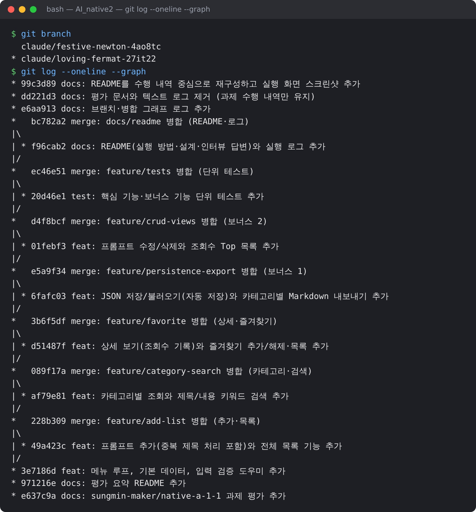

# 프롬프트 관리 프로그램

자주 쓰는 AI 프롬프트를 **등록·분류·검색·즐겨찾기**하고, JSON으로 저장하며 카테고리별 Markdown으로 내보내는 Python 콘솔(메뉴 기반) 프로그램입니다.

- 외부 라이브러리 없이 Python 표준 라이브러리(리스트, 딕셔너리, 함수, 조건문, 반복문)만 사용합니다.
- 프롬프트 데이터는 `data/prompts.json`에 저장되어 다음 실행 때 자동으로 불러옵니다. 파일이 없으면 기본 프롬프트 3개로 시작합니다.

## 실행 방법

Python 3.10 이상, Git이 필요합니다.

```bash
# 1. 저장소 내려받기
git clone https://github.com/duyeop-coder/AI_native2.git
cd AI_native2
git checkout claude/loving-fermat-27it22

# 2. 버전 확인
python3 --version
git --version

# 3. 실행
python3 main.py

# 4. 테스트
python3 -m unittest discover -s tests -t .
```

실행하면 메뉴가 나오고, 번호를 입력해 기능을 선택합니다. `0`을 입력하면 저장 후 종료합니다.

```
===== 프롬프트 관리 =====
1. 프롬프트 추가
2. 전체 목록
3. 카테고리별 조회
4. 키워드 검색
5. 상세 보기
6. 즐겨찾기 추가/해제
7. 즐겨찾기 목록
8. 프롬프트 수정
9. 프롬프트 삭제
10. 조회수 Top 목록
11. JSON 저장
12. JSON 불러오기
13. 카테고리별 Markdown 내보내기
0. 종료
메뉴 번호를 입력하세요:
```

## 기능 목록

| 번호 | 기능 | 설명 |
|---|---|---|
| 1 | 프롬프트 추가 | 제목·내용(빈 값은 재입력)과 카테고리(목록 선택 또는 직접 입력)를 등록합니다. 즐겨찾기 기본값은 해제입니다. 같은 카테고리에 같은 제목이 있으면 덮어쓰기/다른 제목/취소를 고릅니다. |
| 2 | 전체 목록 | 번호, 즐겨찾기(★), 카테고리, 제목을 보여줍니다. |
| 3 | 카테고리별 조회 | 카테고리를 고르면 해당 프롬프트만 보여줍니다. 직접 입력한 카테고리도 목록에 나타납니다. |
| 4 | 키워드 검색 | 제목 또는 내용에 키워드가 포함된 프롬프트를 찾습니다(대소문자 무시). |
| 5 | 상세 보기 | 번호를 입력하면 제목, 카테고리, 즐겨찾기 여부, 조회수, 내용 전체를 보여줍니다. 조회수가 1 올라갑니다. |
| 6 | 즐겨찾기 추가/해제 | 번호를 입력해 즐겨찾기를 토글합니다. |
| 7 | 즐겨찾기 목록 | 즐겨찾기한 프롬프트만 모아서 보여줍니다. |
| 8 | 프롬프트 수정 | Enter로 건너뛰면 기존 값을 유지합니다. |
| 9 | 프롬프트 삭제 | 확인(y/N) 후 삭제합니다. |
| 10 | 조회수 Top 목록 | 조회수 내림차순 Top 5를 보여줍니다. |
| 11 / 12 | JSON 저장 / 불러오기 | `data/prompts.json`에 저장하고 불러옵니다. |
| 13 | Markdown 내보내기 | `exports/<카테고리>.md` 파일을 카테고리별로 만듭니다. |
| 0 | 종료 | 자동 저장 후 종료합니다. |

- 잘못된 메뉴 번호, 숫자가 아닌 입력, 범위를 벗어난 번호에는 안내 메시지를 출력하고 메뉴로 돌아옵니다.
- 조회·검색·즐겨찾기 결과의 번호는 **전체 목록 기준 번호**라서 상세 보기, 즐겨찾기 관리에 그대로 입력할 수 있습니다.

## 프롬프트 카테고리

| 카테고리 | 기본 등록 프롬프트 |
|---|---|
| 이미지 생성 | 제품 홍보 이미지 |
| 글쓰기 | 블로그 초안 작성 |
| 코딩 | 코드 리뷰 요청 |
| 기타 | - |

"직접 입력"을 고르면 새 카테고리를 만들 수 있습니다. 카테고리 체계는 `main.py` 상단의 `CATEGORIES` 상수에서 관리합니다.

## 코드 구조

기능별로 함수를 분리했습니다(`main.py`).

| 함수 | 역할 |
|---|---|
| `show_menu()`, `main()` | 메뉴 출력과 실행 루프 |
| `add_prompt()` | 프롬프트 추가 |
| `show_list()` | 전체 목록 |
| `show_by_category()` | 카테고리별 조회 |
| `search_prompt()` | 키워드 검색 |
| `show_detail()` | 상세 보기 |
| `toggle_favorite()`, `show_favorites()` | 즐겨찾기 관리와 목록 |
| `edit_prompt()`, `delete_prompt()`, `show_top()` | 수정, 삭제, 조회수 Top |
| `save_prompts()`, `load_prompts()`, `export_markdown()` | JSON 저장·불러오기, Markdown 내보내기 |
| `input_non_empty()`, `input_number()`, `choose_category()`, `select_prompt()` | 입력 검증 도우미 |
| `find_prompts()`, `print_matches()`, `print_prompt_line()` | 조회 결과 출력 도우미 |

데이터는 딕셔너리의 리스트입니다.

```python
prompts = [
    {"title": "블로그 초안 작성", "content": "...", "category": "글쓰기", "favorite": False, "views": 0},
]
```

## 실행 화면

Claude Code 터미널에서 명령을 실행한 출력을 터미널 창 모양으로 렌더링한 이미지입니다. 프로그램 화면에서 반복되는 메뉴 출력은 `⋮ (메뉴 출력 생략)`으로 줄였습니다.

| 화면 | 파일 |
|---|---|
| 개발 환경 확인 (Python/Git 버전, Git 설정, Hello 실행) | [01_env.png](docs/screenshots/01_env.png) |
| 프롬프트 추가 (빈 값 재입력 포함) | [02_add.png](docs/screenshots/02_add.png) |
| 잘못된 메뉴 입력, 목록, 카테고리별 조회 | [03_list_category.png](docs/screenshots/03_list_category.png) |
| 검색, 상세 보기 | [04_search_detail.png](docs/screenshots/04_search_detail.png) |
| 즐겨찾기 추가/해제, 즐겨찾기 목록 | [05_favorites.png](docs/screenshots/05_favorites.png) |
| `git log --oneline --graph` | [06_git_log.png](docs/screenshots/06_git_log.png) |
| 공개 샘플 저장소 clone | [07_clone.png](docs/screenshots/07_clone.png) |



## Git 작업 기록

- 기능마다 `feature/*` 브랜치에서 개발하고 `--no-ff`로 병합했습니다: `feature/add-list`, `feature/category-search`, `feature/favorite`, `feature/persistence-export`, `feature/crud-views`, `feature/tests`, `docs/readme`
- 기능 단위로 커밋하고 `git log --oneline --graph`로 브랜치·병합 이력을 확인할 수 있습니다.
